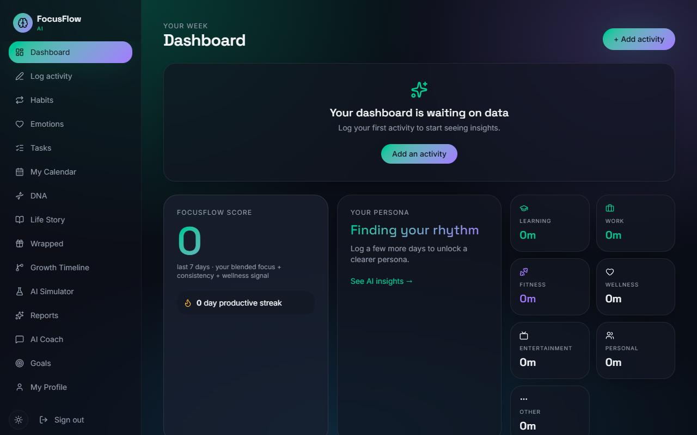
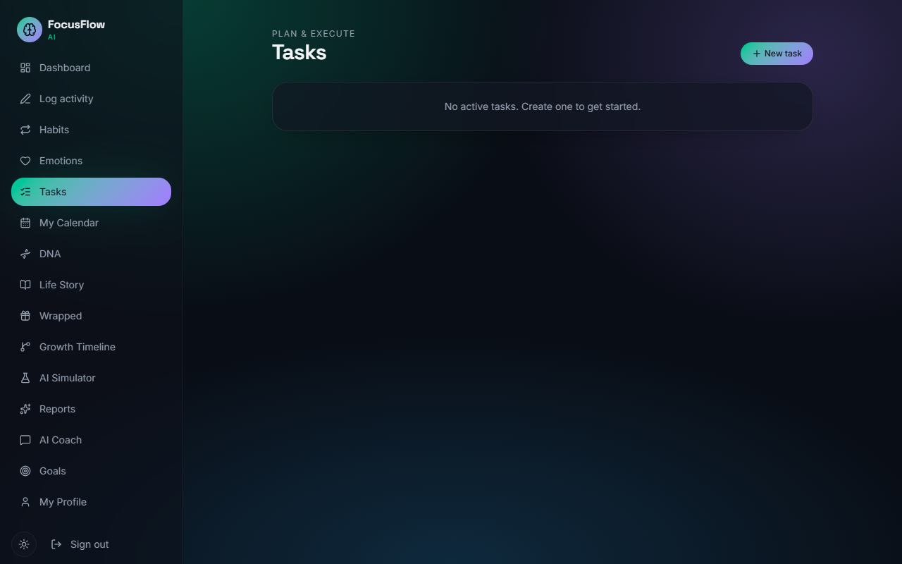
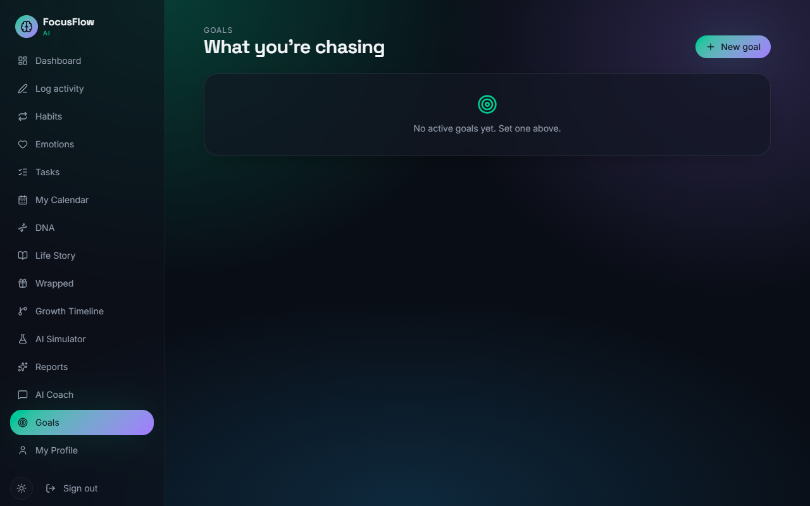
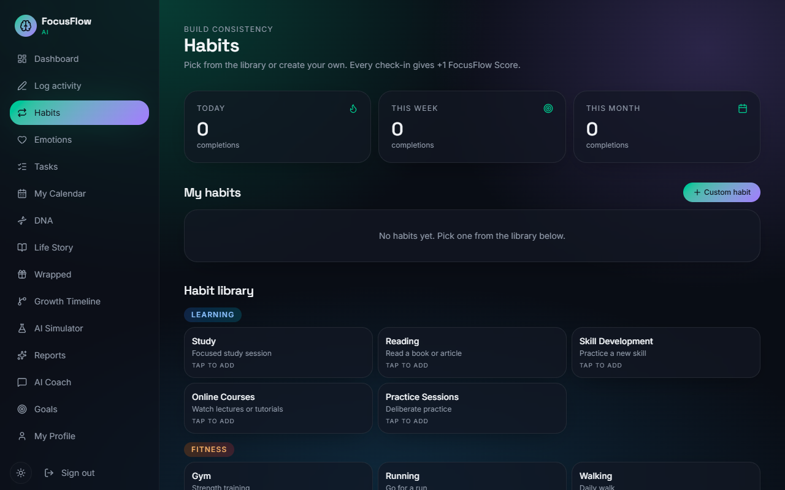
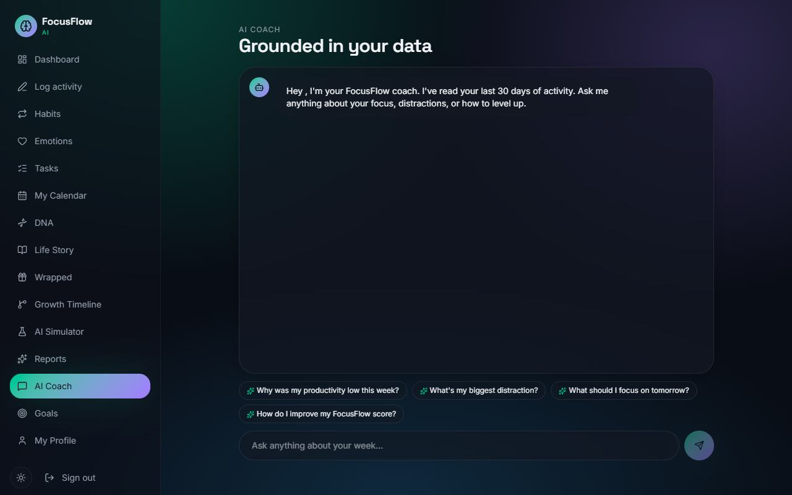
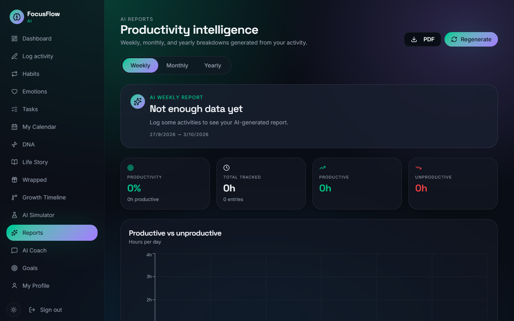
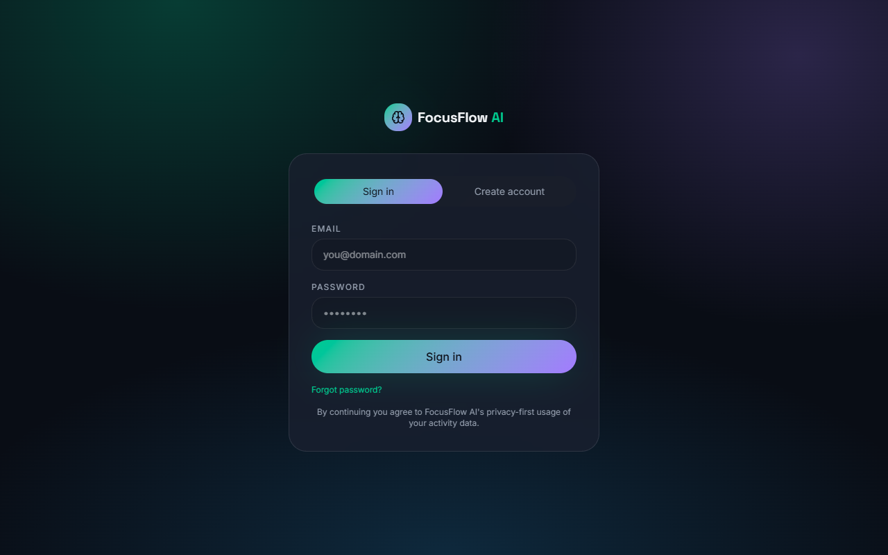
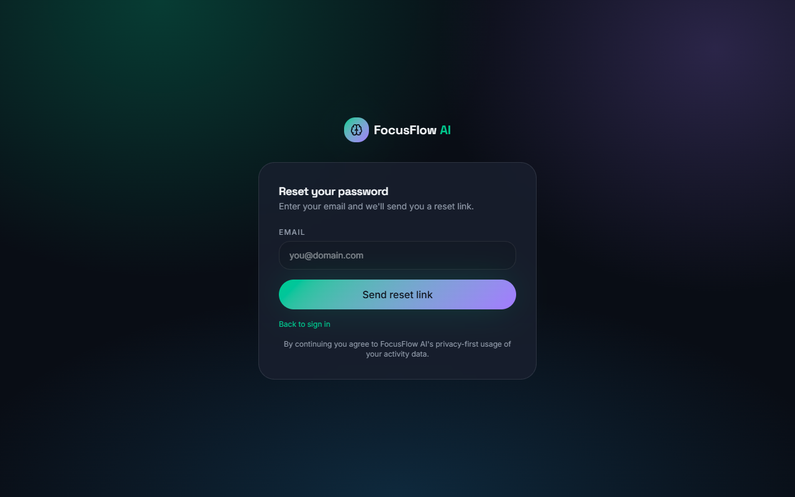

# FocusFlow AI

FocusFlow AI is a personal productivity workspace designed to bring your tasks, goals, habits, reflection, and AI-powered guidance into a single, cohesive experience.


Productivity often becomes fragmented across multiple apps—a to-do list here, a habit tracker there, and an AI chat interface somewhere else entirely. FocusFlow AI unites the relevant pieces together, giving you a centralized dashboard where you can see your day at a glance, reflect on your progress, and receive intelligent coaching to help you achieve your goals.

## Why FocusFlow?

The core idea is simple: **understand what needs your attention without feeling overwhelmed.**

FocusFlow helps you:

- Organize your day-to-day tasks.
- Track long-term goals and tie them to actionable steps.
- Build and maintain positive habits.
- Review detailed reports and insights about your productivity.
- Engage with a personal AI Coach that understands your current workload and provides tailored advice.

## Features

- **📊 Personal Dashboard**: A unified view of your day, highlighting active tasks, daily habits, and current progress.
- **✅ Task Management**: Create, organize, and complete tasks seamlessly.
- **🎯 Goal Tracking**: Set overarching objectives and measure your trajectory.
- **🔁 Habit Tracking**: Monitor daily routines and build streaks over time.
- **🤖 AI Coach**: An integrated AI companion powered by Gemini to provide productivity guidance based on your data.
- **📈 Reports & Insights**: Visual breakdowns of your activities, emotions, and timeline.
- **👤 Profile & Settings**: Manage your account details and preferences.
- **🔐 Secure Authentication**: Robust email and password authentication powered by Supabase.

---

## Product Walkthrough

### 📊 Dashboard

The heart of FocusFlow AI. See a summary of your day, quick actions, and your most pressing tasks.


### ✅ Tasks

A dedicated space to organize everything you need to do.


### 🎯 Goals

Track the bigger picture. Connect daily actions to long-term objectives.


### 🔁 Habits

Build consistency with a clear daily habit tracker.


### 🤖 AI Coach

Your personal productivity mentor, ready to help you plan, prioritize, or brainstorm.


### 📈 Reports & Insights

Reflect on your journey with detailed analytics and timelines.


### 🔐 Authentication

A complete, secure authentication flow including sign in, sign up, and password resets.



---

## How it Works

1. **Sign Up**: Create an account with your email and password.
2. **Personal Workspace**: Arrive at your clean, organized dashboard.
3. **Add Items**: Start adding your tasks, setting up habits, and defining goals.
4. **Track Progress**: Mark items as complete as you move through your day.
5. **Use AI Coach**: Feeling stuck? Ask the AI Coach for help breaking down a big task.
6. **Review Insights**: Look back at your weekly reports to understand your productivity patterns.

## Tech Stack

| Technology          | Purpose                                         |
| :------------------ | :---------------------------------------------- |
| **React**           | Frontend UI Library                             |
| **TypeScript**      | Type safety and reliable code                   |
| **Vite**            | Lightning-fast development server and bundler   |
| **Supabase**        | Backend-as-a-Service (Database, Authentication) |
| **Tailwind CSS**    | Utility-first styling and responsive design     |
| **TanStack Router** | Type-safe, powerful routing                     |
| **Gemini API**      | Generative AI integration for the AI Coach      |

## Project Structure

```
FocusFlowAI/
├── src/
│   ├── components/       # Reusable UI components (Tailwind/Radix based)
│   ├── integrations/     # Third-party integrations (Supabase client)
│   ├── lib/              # Utility functions and shared logic
│   ├── routes/           # TanStack Router page definitions
│   └── index.css         # Global styles and Tailwind directives
├── docs/
│   └── screenshots/      # Documentation images
├── public/               # Static assets
├── package.json          # Project dependencies and scripts
└── README.md             # This file
```

## Getting Started

To run FocusFlow AI locally:

1. **Clone the repository**

   ```bash
   git clone https://github.com/pranavmoff/FocusFlowAI.git
   cd FocusFlowAI
   ```

2. **Install dependencies**

   ```bash
   npm install
   ```

3. **Configure environment variables**
   Copy `.env.example` to `.env` (or `.env.local`) and fill in your Supabase credentials:

   ```bash
   cp .env.example .env
   ```

4. **Start the development server**

   ```bash
   npm run dev
   ```

5. **Build for production**
   ```bash
   npm run build
   ```

## Environment Variables

The project requires the following environment variables to function correctly. A `.env.example` file is provided in the repository.

```
VITE_SUPABASE_URL=your-supabase-project-url
VITE_SUPABASE_PUBLISHABLE_KEY=your-supabase-anon-key
VITE_SITE_URL=http://localhost:8081
GEMINI_API_KEY=your-gemini-api-key
```

_Note: You can get a free Gemini API key from Google AI Studio. The Supabase credentials are found in your Supabase project settings._

## Authentication Flow

FocusFlow AI uses Supabase for a complete, secure authentication system:

- **Sign Up**: Users can create an account using an email address and a strong password.
- **Email Verification**: (Optional depending on Supabase configuration) Account confirmation via email.
- **Sign In**: Standard email/password login.
- **Forgot Password & Reset**: Users can request a secure reset link to their email, routing them to a dedicated password reset page within the application to update their credentials safely.

## Security Notes

- **Secrets**: Sensitive keys (like the Supabase `service_role` key or database password) are NEVER stored in the frontend codebase.
- **Environment Variables**: Use `.env` files for local configuration and ensure they are added to `.gitignore`.
- **Exposed Keys**: Only the public, publishable Supabase URL and anon key (`VITE_SUPABASE_URL`, `VITE_SUPABASE_PUBLISHABLE_KEY`) are safe to include in the frontend bundle.

## 🚀 What's Next?

Future improvements could include:

- **Calendar Integrations**: Syncing tasks directly with Google or Outlook calendars.
- **Mobile App**: Wrapping the responsive web app in a progressive web app (PWA) or React Native for native mobile experiences.
- **Advanced AI Agents**: Expanding the AI Coach to proactively suggest schedule adjustments based on current progress.
- **Team Collaboration**: Introducing shared goals or team accountability features.

## 👨‍💻 Built By

**Pranav M**
